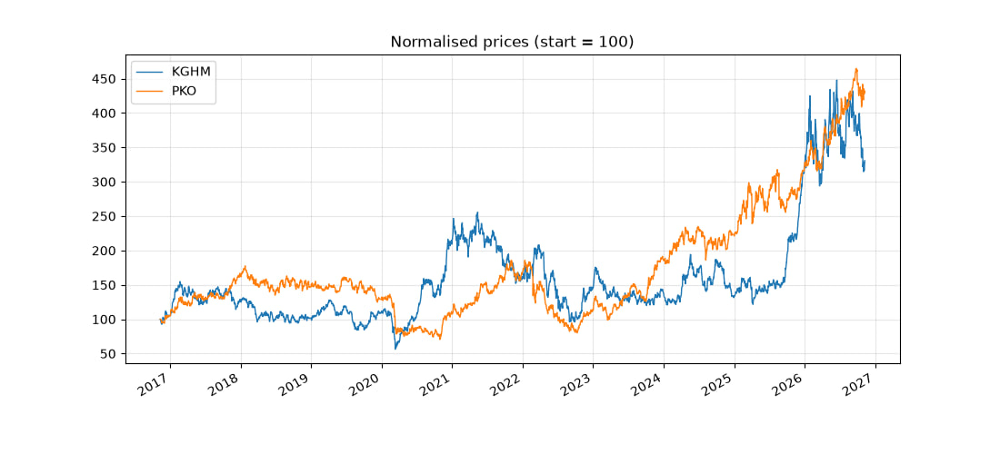
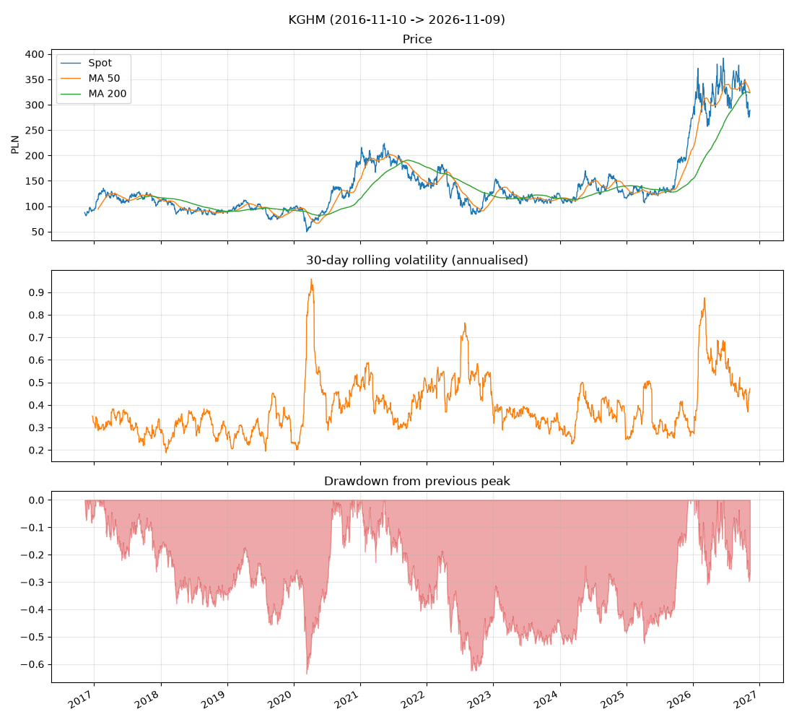
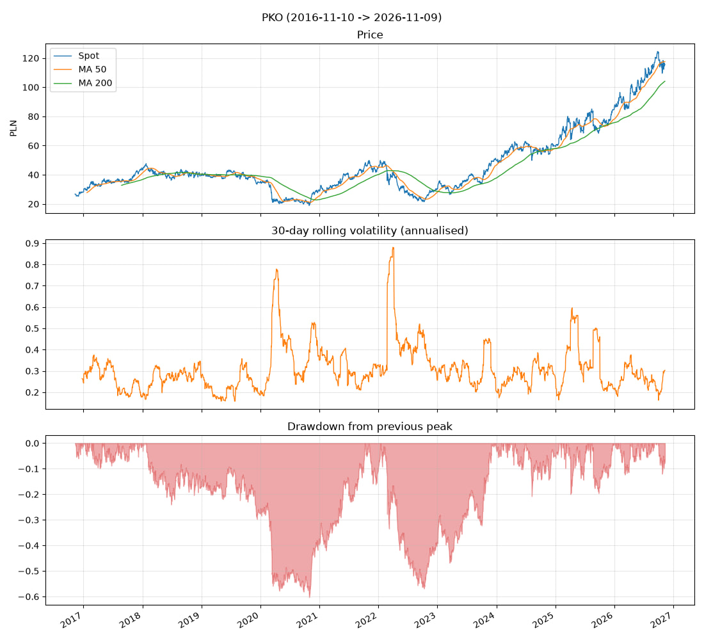

# Futures fair-value analysis and arbitrage backtest (KGHM, PKO)

A Python-based quantitative finance project designed to evaluate stock futures contracts traded on the Warsaw Stock Exchange (GPW), specifically focusing on **KGHM Polska Miedź** and **PKO Bank Polski**. The project implements the classical **cost-of-carry pricing model**, identifies market misalignments, evaluates arbitrage opportunities, and accounts for transaction costs.

---

## Project Structure

```text
futures-arbitrage-analysis/
│
├── data/                  # Historical CSV datasets for spot & futures prices
│   ├── kghm_data.csv      # KGHM market data
│   └── pko_data.csv       # PKO BP market data
│
├── output/                # Generated visualizations and analysis reports
│   └── kghm_valuation.png
│
├── src/                   # Core source package
│   ├── __init__.py
│   ├── analysis.py        # Spread computation and arbitrage status classification
│   ├── plots.py           # Data visualization generator (Matplotlib)
│   └── pricing.py         # Cost-of-carry theoretical pricing engine
│
├── Test/                  # Test modules and experimental scripts
├── arbitrage.py           # Feasibility analysis factoring in transaction costs
├── download_data.py       # Utility for downloading/fetching market data feeds
├── extract_data.py        # Data parser and preprocessing utility
├── main.py                # Main orchestration pipeline script
├── requirements.txt       # Project dependencies
└── README.md              # Project documentation
```

---

##  Mathematical Model

The theoretical futures price is modeled using continuous compounding under the cost-of-carry framework:

$$F_0 = S_0 e^{(r - q)T}$$

Where:
* $S_0$ = Current spot price of the underlying asset
* $r$ = Risk-free interest rate (e.g., WIBOR 3M = $5.24\%$)
* $q$ = Annualized dividend yield (5.45\%)
* $T$ = Time to maturity expressed in years

---

## Arbitrage Strategies

Depending on the relationship between the market futures price and the theoretical price :

1. **Overvalued Contract:**
   * **Strategy:** Sell (short) futures contracts and buy (long) the underlying stock in the spot market.
2. **Undervalued Contract:**
   * **Strategy:** Buy (long) futures contracts and sell (short) the underlying stock.
   *(Note: Execution requires verifying that the absolute spread exceeds transaction costs and borrowing fees).*

---      

## Results from spot data (2016-11-10 -> 2026-11-09)

All charts use raw (not dividend-adjusted) closing prices.

### Normalised prices


### KGHM


### PKO


### Key figures (approximate, read from the charts)

| | KGHM | PKO |
|---|---|---|
| Price at start (Nov 2016) | ~85 PLN | ~26 PLN |
| Price now (Nov 2026) | ~285 PLN | ~117 PLN |
| Growth, price only | ~3.3x | ~4.3x |
| Peak | ~390 PLN (early 2026) | ~124 PLN (autumn 2026) |
| Typical 30-day volatility (annualised) | 0.3 - 0.5 | 0.2 - 0.35 |
| Highest volatility | ~0.96 (spring 2020) | ~0.88 (early 2022) |
| Worst drawdown | ~ -64% (March 2020) | ~ -60% (late 2020) |
| Current drawdown from peak | ~ -30% | ~ -10% |
| Spot vs moving averages now | below MA 50 and MA 200 | about MA 50, above MA 200 |

## Conclusions

1. **KGHM is the riskier stock.** Its volatility usually sits at 0.3 - 0.5, against
   0.2 - 0.35 for PKO, and it spent long periods below its previous peak: roughly
   2017 - 2020, and again from the 2021 high until late 2025, more than four years.
2. **PKO shows a steadier trend.** Since the 2022 low (~22 PLN) it rose about fivefold,
   and since 2024 its drawdowns were mostly shallower than 20%.
3. **Both stocks suffered in the same crises.** In 2020 and in 2022 both had
   drawdowns of more than 55% and sharp volatility spikes, so holding the two together
   did not protect against those episodes.
4. **Outside crises they moved very differently.** From 2023 to 2025 PKO kept rising
   while KGHM stayed in a range of about 110 - 150 PLN. Then KGHM more than doubled in a
   few months around the turn of 2025/2026, with volatility near 0.88.
5. **Current state.** KGHM is about 30% below its early-2026 peak, below both moving
   averages, with volatility (~0.47) above its usual level. PKO is close to its highs
   with moderate volatility (~0.3). The moving averages are lagging indicators and are
   only descriptive here.

### What this means for the futures part of the project (hypotheses to test)

- **Regimes differ a lot.** A futures contract lives for about a year, so one contract
  can fall into a calm period or into a turbulent one (for example, a contract covering
  2025 - early 2026 includes KGHM's big rally). Backtest results from a single contract
  should not be generalised.
- **Mispricing may widen when volatility spikes** (2020, 2022, 2026), and costs such as
  margin and short-selling constraints are likely higher then. The charts do not prove
  this; it should be checked against the futures data.
- **Constant r and q are a weak assumption over 10 years.** Interest rates changed
  strongly between these years, so use `--rates` with a WIBOR 3M series, and a
  dividend yield per year instead of one number.
- **Dividends affect the comparison.** Raw closes drop on ex-dividend days, and the
  growth figures above exclude dividends (the real total return is higher).

## Limitations
- The charts and conclusions are descriptive, based on spot prices only. They are not
  predictions or investment advice.